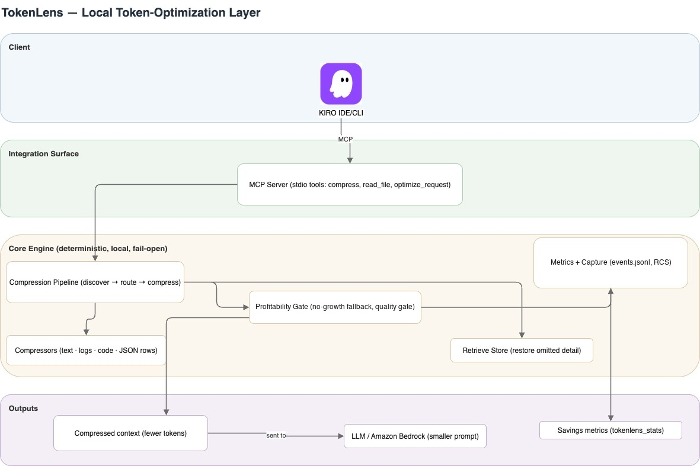

# TokenLens

Local, deterministic token optimization for LLM development workflows.
TokenLens compresses large context before it reaches the model and records
measured savings. Compression is profitability gated and fail-open.

> **Software status:** Beta software for demonstration and development use. It is
> not an AWS service and carries no AWS Support commitment, service-level
> agreement, or production warranty. See [SUPPORT.md](SUPPORT.md).


## Architecture




## Integration surfaces

| Adapter | Use | Model credentials |
| --- | --- | --- |
| MCP server (`tokenlens mcp`) | Kiro and other MCP clients | None |
| Python library (`tokenlens.api`) | Embedded agent or pipeline integration | None |
| Keyed proxy (`tokenlens start`) | Direct Anthropic-compatible requests | Required |

For production AWS workloads, prefer TokenLens library optimization before
Amazon Bedrock Converse API calls, or configure the keyed proxy with an approved
Anthropic-compatible gateway. Default proxy endpoint calls Anthropic directly.

## Requirements

- Python 3.11+
- macOS or Linux for automated Kiro installation
- `pipx` or `uv` for isolated CLI installation

## Install

After version 0.2.0 is published to your approved Python registry:

```bash
# Run from the downloaded release directory.
pipx install --pip-args="--constraint ./constraints-release.txt" \
  "aws-samples-tokenlens[mcp,tokenizers]==0.2.0"
# or
uv tool install --constraints ./constraints-release.txt \
  --with "mcp==1.29.1" --with "tiktoken==0.13.0" "aws-samples-tokenlens==0.2.0"
```

Always install with `constraints-release.txt` applied, as above. The `mcp` and
`tokenizers` extras declare version ranges, and only the exact versions in the
constraints file are release-validated; an unconstrained install may resolve
newer in-range dependency versions that have not been tested.

### Kiro one-click setup

Run once per workspace:

```bash
tokenlens kiro install --workspace /path/to/project
tokenlens kiro doctor --workspace /path/to/project
```

This safely installs:

- workspace MCP registration using a verified TokenLens Python interpreter;
- always-on steering for disciplined retrieval;
- v1 `PreToolUse` routing for large native text reads;
- ownership manifest and hashes for repeatable upgrades and removal.

Installation ends with a validation step that starts the registered MCP server
and reports whether Kiro will be able to run it:

```text
Validation: MCP server registered and starts correctly.
```

If validation fails, the files stay in place, the specific reason is printed, and
the command exits non-zero. Rerun the check at any time with
`tokenlens kiro doctor`, or probe the server directly with
`tokenlens mcp --probe`. Use `--no-verify` on install or `--no-probe` on doctor
to skip starting the server.

Two failures this catches, both of which previously produced a workspace that
looked installed while Kiro reported the server as unavailable:

- **Wrong interpreter.** The registration must use a Python that can import
  `tokenlens`. A virtual environment's `python` is often a symlink into a base
  installation without TokenLens, so the installer verifies candidates instead
  of writing a resolved symlink target.
- **Unsupported MCP SDK.** TokenLens uses the MCP Python SDK 1.x server API
  (`mcp>=1.2,<2`). Plain `pip install mcp` now resolves to 2.x, which removed
  that API. Install the `mcp` extra with `constraints-release.txt` applied.

Default MCP scope is workspace-local. Use `--mcp-scope user` for a shared
`~/.kiro/settings/mcp.json` registration. Steering and hooks remain workspace
assets. Reconnect Kiro after installation.

A pinned release bootstrap is available as `scripts/install-kiro.sh`:

```bash
./scripts/install-kiro.sh /path/to/project
```

The script installs from the release wheel beside it (or in `dist/`) when one is
present, and falls back to the package registry once TokenLens is published. It
verifies the resolved CLI version, confirms `tokenlens` is on `PATH`, probes the
MCP server before touching the workspace, runs the Kiro installer, and runs
health checks. Stock 0.1 legacy hooks are removed during migration; customized
legacy hooks are preserved and reported for manual review. Do not distribute the
script through an unverified `curl | sh` flow; publish it with release checksums.

Remove only installer-owned state:

```bash
tokenlens kiro uninstall --workspace /path/to/project
```

Installer refuses to overwrite or remove locally modified managed files unless
`--force` is explicitly supplied. Forced replacement snapshots pre-existing
workspace files and restores them on uninstall. Existing MCP configuration is
backed up and unrelated servers are preserved.

### Local development

```bash
python3.12 -m venv .venv
source .venv/bin/activate
pip install -c constraints-release.txt -e ".[dev,tokenizers,mcp]"
```

## MCP tools

- `tokenlens_compress` — compress large tool output, logs, rows, or pasted text
- `tokenlens_read_file` — read UTF-8 text through compressed read path
- `tokenlens_optimize_request` — optimize Anthropic-style request body
- `tokenlens_postprocess_response` — remove response filler when enabled
- `tokenlens_stats` — report accumulated measured savings
- `tokenlens_retrieve` — retrieve original content from the Reversible Content
  Store (RCS) when RCS is enabled

Manual MCP registration remains supported:

```json
{
  "mcpServers": {
    "tokenlens": {
      "command": "/absolute/path/to/python",
      "args": ["-m", "tokenlens", "mcp"]
    }
  }
}
```

Use automated installer when possible; it resolves correct interpreter and
merges JSON safely. `power/` remains optional Kiro discovery bundle, not primary
always-on installation mechanism.

## Runtime behavior

Optimization pipeline includes:

| Stage | Default |
| --- | --- |
| Context compression | On |
| Prefix stabilization | On |
| Metrics | On |
| History trimming through `tokenlens_optimize_request` | On |
| Smart model routing | Off |
| Output constraints | Off |
| Response post-processing | Off |
| Capture and RCS storage | Off |

Kiro routing has two thresholds:

- 8 KB hook prefilter (`TOKENLENS_READ_HOOK_MIN_BYTES`)
- 2,000-token MCP compression threshold
  (`TOKENLENS_ALWAYS_ON_READ_ROUTING_THRESHOLD`)

Disable generic large-read compression with
`TOKENLENS_ALWAYS_ON_READ_ROUTING_ENABLED=false`.

## Configuration

Resolution order: built-in defaults, optional `tokenlens.yaml`, then
`TOKENLENS_*` environment variables.

```bash
tokenlens example-config > tokenlens.yaml
export TOKENLENS_COMPRESSION_MODE=aggressive
export TOKENLENS_POSTPROCESS_ENABLED=true
```

Capture records measurements only unless content storage is explicitly enabled.

### Safety and privacy limitations

Read these before relying on TokenLens in a sensitive workspace.

- **Sensitive-path refusal is pattern matching, not a security boundary.**
  Compressed reads deny known secret directories, filenames, suffixes, and
  null-byte paths. This is defense in depth. It is not a sandbox, not workspace
  confinement, and not an authorization control. Do not treat it as a
  substitute for file permissions or secret management.
- **Compression is lossy by design.** JSON arrays are sampled, unchanged diff
  runs are collapsed, long function bodies are elided, and low-signal log runs
  are dropped. Errors, warnings, signatures, paths, identifiers, and recent
  history are preserved, but no semantic-equivalence guarantee exists. Enable
  RCS (`TOKENLENS_RCS_ENABLED=true`) when full recovery matters, then use
  `tokenlens_retrieve`.
- **Fail-open applies after a successful safe read.** Disallowed, oversized,
  binary, or unreadable paths return a structured error rather than content.
- **The Kiro hook blocks large native text reads.** It instructs the agent to
  narrow the search or retry through `tokenlens_read_file`. Disable it with
  `TOKENLENS_ALWAYS_ON_READ_ROUTING_ENABLED=false` or by uninstalling the hook
  if that behavior is unwanted.
- **Metrics are local and content-free by default.** `.tokenlens/events.jsonl`
  records counts, stages, model, and routing. Optional capture content samples
  apply best-effort redaction that is explicitly not guaranteed; keep capture
  off unless required.
- **The keyed proxy is the only network component.** It holds model credentials
  and defaults to calling Anthropic directly. Point it at an approved gateway
  where policy requires one.

## Measure and validate

```bash
tokenlens bench
tokenlens stats
tokenlens eval
```

`bench` uses a fixture packaged inside wheel when no path is given. `eval`
verifies critical information survives compression and exits non-zero on a
quality failure. No model credentials or network calls are required.

### How to state TokenLens numbers

TokenLens reports **estimated** tokens, counted with `cl100k_base` when optional
`tiktoken` is installed and a character-based approximation otherwise. They are
not provider invoices, Kiro credit statements, latency measurements, or evidence
of unchanged task outcomes.

| Output | What it measures | Required wording |
| --- | --- | --- |
| `bench` on packaged fixtures | Three synthetic, deliberately repetitive stress fixtures (`fixtures/generate_fixtures.py`) | "96.84% estimated token reduction on three synthetic high-noise fixtures" |
| `eval` | Retention of extractor-defined critical markers | "14/14 predefined critical markers retained in the synthetic suite" |
| `stats` | Savings-positive TokenLens events only | Report absolute tokens saved; do not publish a whole-workload percentage |

Rules:

- Never present the fixture result as project, portfolio, or customer savings.
- Keep the 0% plain-text `eval` case visible; TokenLens declines unprofitable
  work, and that is a correctness property worth showing.
- `stats` omits no-op calls and all traffic that bypasses TokenLens, so it has no
  complete denominator. A whole-workload rate requires a dated export with task
  provenance and outcomes.
- Convert to business value only from measured billed cost or platform credits
  per accepted task, never from estimated input tokens.
- `eval` checks known markers, not semantics. Do not claim critical information
  is always preserved.

### Referring to comparable projects

Other projects and studies address adjacent problems. When citing them:

- Use plain nominative references and their own reported figures.
- Label provenance: project self-reported, third-party evaluation, or research.
- Do not publish side-by-side tables that rank TokenLens against a named project
  on numbers produced by different methods, workloads, and fixtures.
- Do not imply endorsement, affiliation, or that a named project is inferior.

## Community and project policies

- [Contributing](CONTRIBUTING.md)
- [Code of Conduct](CODE_OF_CONDUCT.md)
- [Security policy](SECURITY.md)
- [Support policy](SUPPORT.md)
- [Changelog](CHANGELOG.md)
- [Release process](RELEASING.md)
- [License](LICENSE)

## Build release

```bash
PYTHON=venv/bin/python ./scripts/build-release.sh
```

Release script runs full tests, validates Power and Skill bundles, builds wheel
and source archive, copies installer bootstrap plus exact dependency constraints,
and writes `dist/SHA256SUMS` covering all four release artifacts.

## Development

```bash
pytest -q
```

Core engine lives under `src/tokenlens/`. Kiro installer and hook are
`kiro_install.py` and `kiro_hook.py`. Packaged integration assets live under
`src/tokenlens/resources/`. `power/` and `skill/` are optional agent discovery
bundles.

## License

Licensed under the [MIT No Attribution (MIT-0) License](LICENSE).
